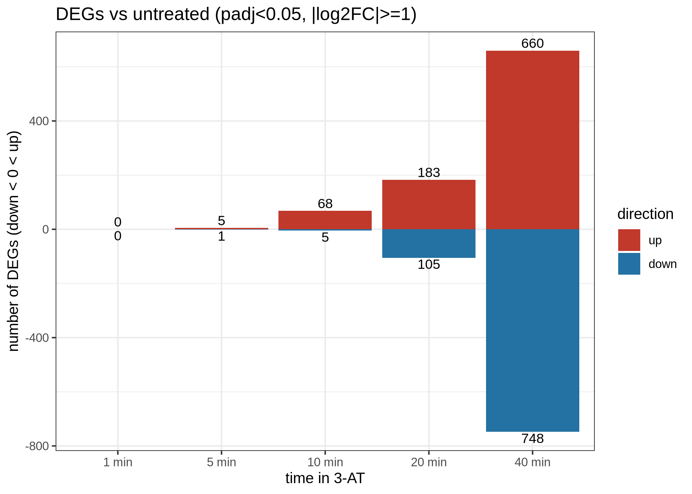
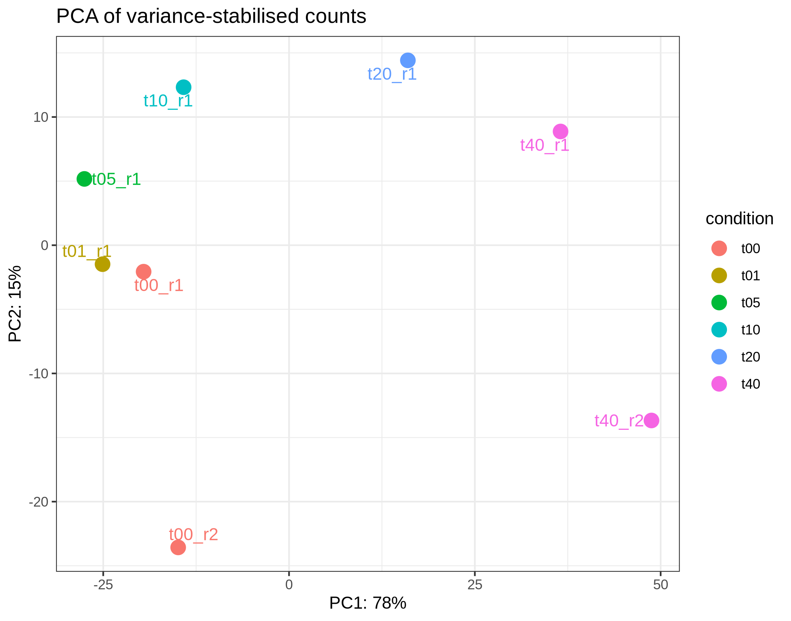
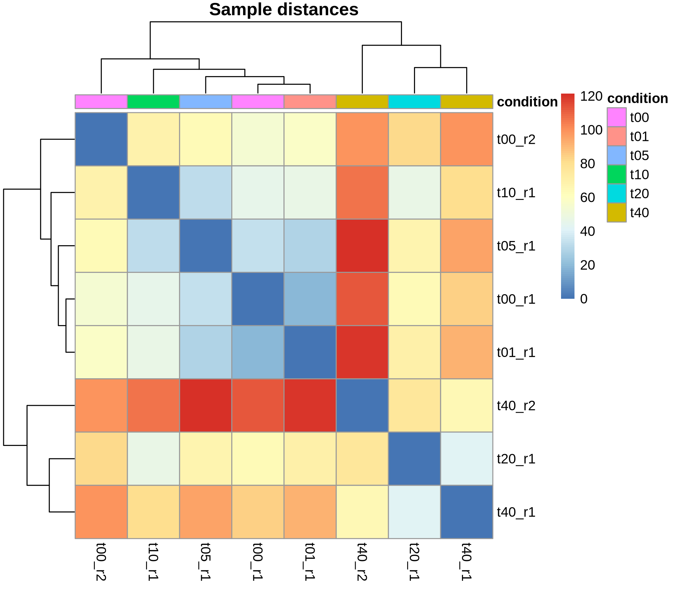
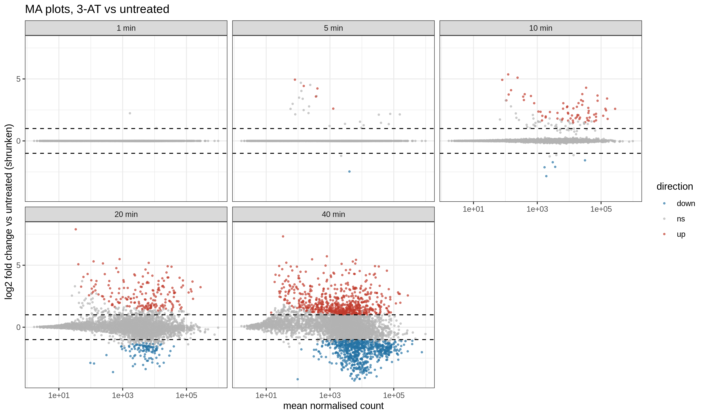
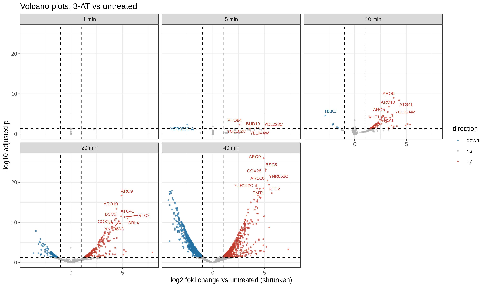
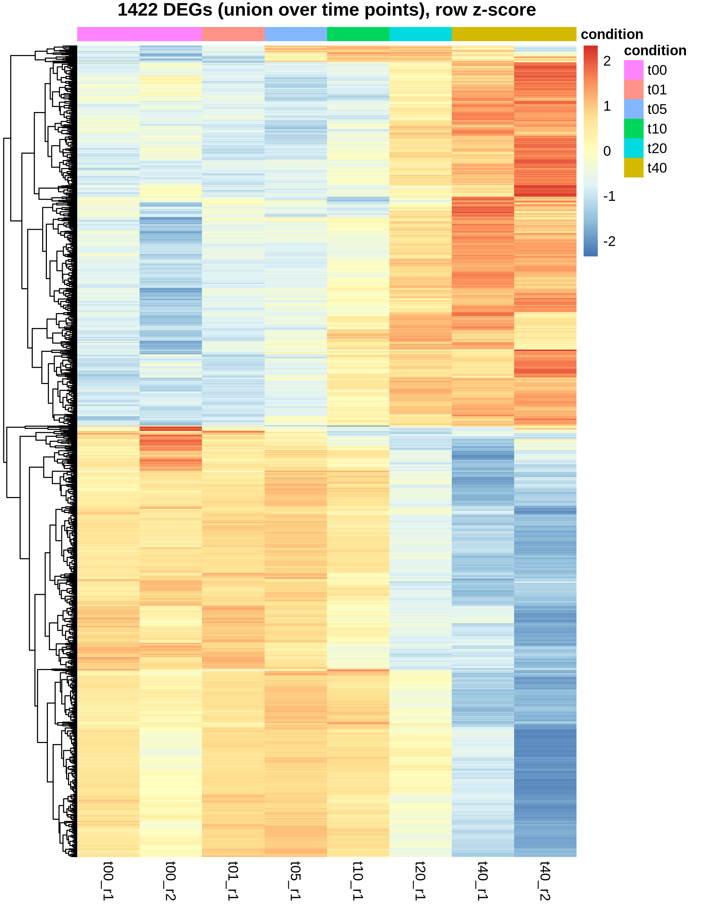
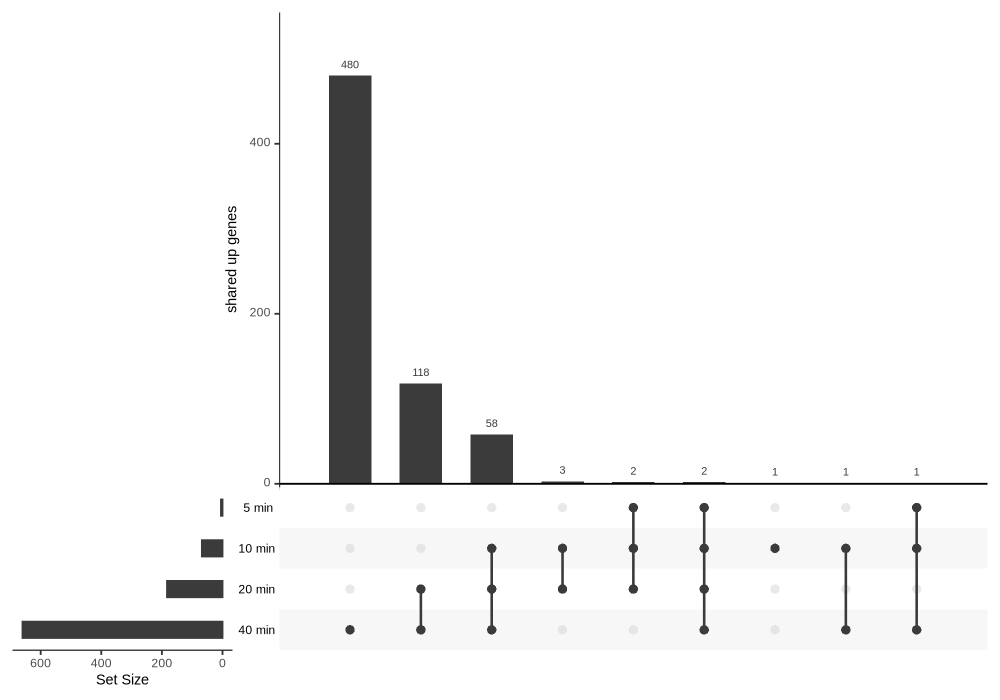
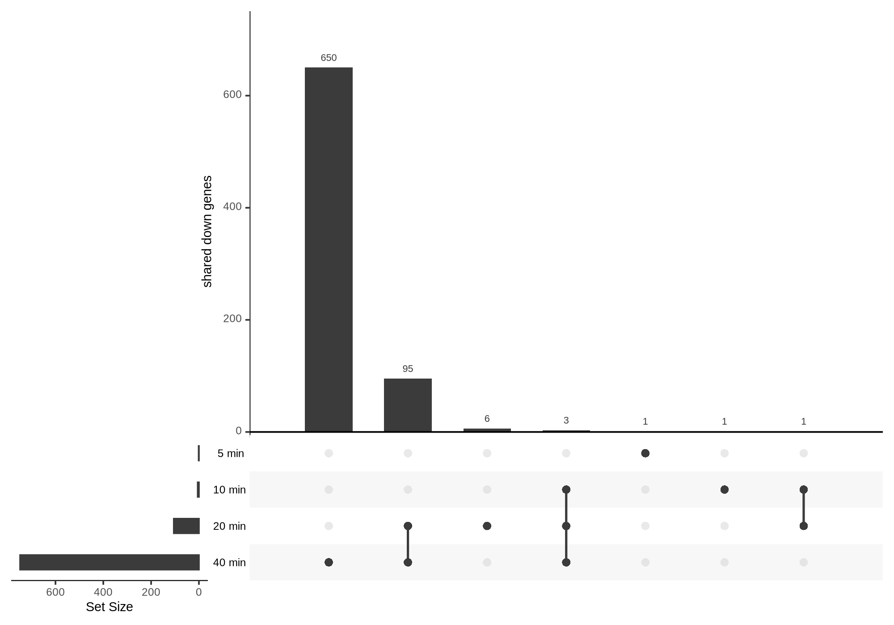
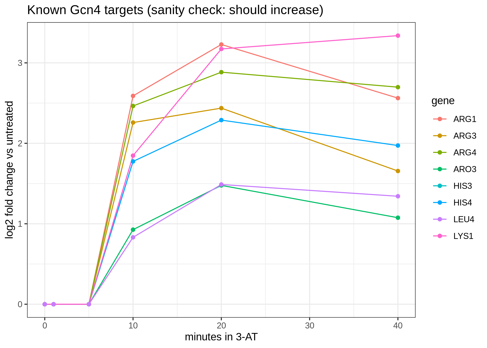
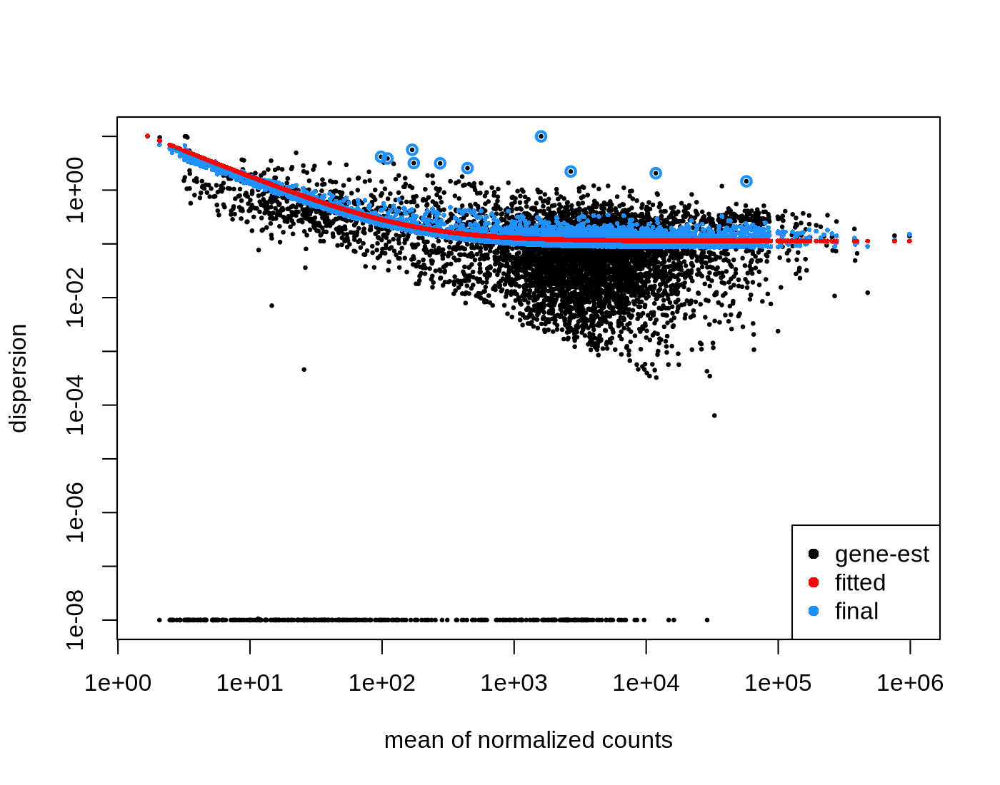

# Time-course RNA-seq of the 3-AT starvation response in *S. cerevisiae* (GSE110413)

## Aim
3-amino-1,2,4-triazole (3-AT) blocks His3p and causes sudden histidine starvation, which switches on the General Amino Acid Control (GAAC) pathway through the transcription factor Gcn4. Here I ran a RNA-seq differential expression workflow on yeast treated with 3-AT for 1, 5, 10, 20 and 40 minutes and compared each time point with the untreated control (0 min), to find the DEGs at each time point and see how the response develops.

## Data
8 paired-end Illumina libraries (sacCer3). The untreated control (t00) and 40 min (t40) each have 2 replicates; t01, t05, t10 and t20 are single libraries.

| SRA run | Sample | Condition | Read pairs | Compressed FASTQ (R1+R2) | HISAT2 overall alignment |
|---|---|---|---|---|---|
| SRR6703656 | t00_r1 | Untreated | 62,112,216 | 2.8G + 3.0G | 91.86% |
| SRR6703662 | t00_r2 | Untreated | 42,288,466 | 1.4G + 1.9G | 96.18% |
| SRR6703657 | t01_r1 | 1 min | 61,192,194 | 2.8G + 3.0G | 89.41% |
| SRR6703658 | t05_r1 | 5 min | 62,527,904 | 2.8G + 3.0G | 92.10% |
| SRR6703659 | t10_r1 | 10 min | 108,337,634 | 4.9G + 5.3G | 94.95% |
| SRR6703660 | t20_r1 | 20 min | 70,777,597 | 3.2G + 3.5G | 95.36% |
| SRR6703661 | t40_r1 | 40 min | 67,700,726 | 3.1G + 3.3G | 89.61% |
| SRR6703663 | t40_r2 | 40 min | 48,365,805 | 1.6G + 2.2G | 96.17% |

## Tools
SRA-Toolkit (prefetch, fasterq-dump), pigz, FastQC and MultiQC, HISAT2, samtools, subread (featureCounts), R with DESeq2, apeglm, ggplot2, pheatmap, ggrepel, UpSetR, TxDb.Scerevisiae.UCSC.sacCer3.sgdGene and org.Sc.sgd.db. Everything is installed in one conda environment (`scripts/01_create_conda_env.sh`).

## Procedure
Run the scripts in `scripts/` in numerical order (steps 01 to 10 in the terminal), then `rna_deseq2_clean.R` in R.

1. **Environment, variables and folders** (`01`, `02`): one conda environment, then shortcuts for the project folder, the index prefix and the number of threads.
2. **Genome index** (`03`): download sacCer3 from UCSC and build the HISAT2 index.
3. **Sample sheet** (`04`, also `rna_samples.csv`): run, sample name, time point and replicate. DESeq2 uses it later as the design table.
4. **Download reads** (`05`): `prefetch`, `fasterq-dump --split-files` and `pigz`, giving 16 FASTQ files (8 pairs).
5. **Read QC** (`06`): FastQC on every file, merged with MultiQC. Reads were good enough that I did no trimming.
6. **Alignment** (`07`): HISAT2 with `--max-intronlen 2000` (yeast introns are short), piped into `samtools sort` and indexed. Duplicates are not removed in RNA-seq.
7. **Gene annotation** (`08`): the yeast gene model is written as a SAF table (systematic ORF names such as YOL058W).
8. **Strandedness test** (`09`): featureCounts on t00_r1 with `-s 0`, `-s 1` and `-s 2`. The mode with clearly the most assigned pairs is the right one.
9. **Counting** (`10`): featureCounts on all BAMs with `-p --countReadPairs -s 2 -B -C`, giving `counts/counts_raw.txt`.
10. **DESeq2** (`rna_deseq2_clean.R`): thresholds are padj < 0.05 and |log2FC| >= 1; genes with fewer than 10 reads in at least 2 samples are removed; `DESeq()` fits the model with t00 as the reference, `vst()` gives values for plotting, and `lfcShrink(type = 'apeglm')` shrinks the fold changes of low-count genes. A gene is called up or down only if padj < 0.05 and its shrunken |log2FC| >= 1. Result tables are written per time point, plus a summary table and a wide table with all time points.
11. **Plots**: DEG counts, PCA, sample distances, MA, volcano, heatmap, UpSet, known Gcn4 targets and dispersion plots, all at the end of the R script.

## Results

Alignment rates ranged from 89.41% (t01_r1) to 96.18% (t00_r2). On t00_r1 the strandedness test gave 86,955,890 assigned pairs unstranded, 6,150,051 forward (`-s 1`) and 91,412,263 reverse (`-s 2`), so the library is reversely stranded (dUTP/TruSeq) and `-s 2` was used. After filtering, 6,358 genes were tested.

### DEGs at each time point (vs t00)

| Comparison | Up | Down | Total | Comment |
|---|---|---|---|---|
| 1 min | 0 | 0 | 0 | No detectable change; lag before transcripts change |
| 5 min | 5 | 1 | 6 | First responders appear |
| 10 min | 68 | 5 | 73 | Rapid induction of Gcn4 targets |
| 20 min | 183 | 105 | 288 | Induction expands; repression begins |
| 40 min | 660 | 748 | 1,408 | Large-scale remodelling (about 22% of tested genes) |

In total 1,422 unique genes were differentially expressed in at least one comparison.



*Number of up- and down-regulated DEGs per time point.* Nothing is detected at 1 min, 6 genes at 5 min, 73 at 10 min and 288 at 20 min. At 40 min there are 1,408 DEGs (660 up, 748 down), so induction leads up to 20 min and repression catches up and overtakes it at 40 min. Part of the jump at 40 min comes from having two replicates there, which gives more statistical power.

### PCA


PC1 (78% of variance) is ordered by time in 3-AT: t00, t01 and t05 sit at the far left, t10 just behind them, t20 at the centre-right and the two t40 libraries furthest right. The early time points (0 to 5 min) are almost indistinguishable, which matches the DEG counts. PC2 (15%) separates the replicate-2 libraries (t00_r2, t40_r2) from the replicate-1 libraries, which looks like a batch or depth effect confounded with replicate.

### Sample distances


The libraries split into an early/untreated group (t00_r1, t01_r1, t05_r1, t10_r1, t00_r2) and a late group (t20_r1, t40_r1, t40_r2). t00_r1 and t01_r1 are the closest pair. The big switch therefore happens between 10 and 20 min. t40_r2 is further from t40_r1, again a replicate effect and not a different response.

### MA plots


At 1 min fold changes collapse to zero and at 5 min only a few low-abundance genes pass the threshold. By 10 min induced genes dominate over a wide expression range. At 20 and 40 min a dense cloud of downregulated genes appears at moderate to high expression (roughly 10^3 to 10^5 mean normalised counts). This fits repression of abundant ribosome-related transcripts, but I did not test that here (no enrichment analysis). The symmetric spread at low expression shows that shrinkage is controlling noise from low-count genes.

### Volcano plots and top responders


Labelled genes: at 5 min PHO84, BUD19, YDL228C, YGL102C and YLL044W (up) and YER053C-A (down); at 10 min ARO9, ARO10, ARO5, ATG41, VHT1, ICY1 and YGL024W (up) and HXK1 (down); at 20 and 40 min ARO9, ARO10, BSC5, COX26, ATG41, RTC2, TMT1, YNR068C, YLR152C and SRL4 (up). ARO9 and ARO10 are among the strongest hits from 10 min onward and significance goes above -log10(padj) of 25 at 40 min. The early top hits include aromatic amino acid metabolism genes (ARO5, ARO9, ARO10), in line with an amino acid starvation response.

### Heatmap of all DEGs


Row z-scores of the 1,422 DEGs. Two anti-correlated modules are visible. Induced genes are low from t00 to t05, rise through t10 and t20 and peak in both t40 libraries; repressed genes are high through t10, fall at t20 and are lowest at t40. The change is gradual, not a single step. t40_r2 shows stronger repression than t40_r1, so the size differs between replicates but the direction is the same.

### Overlap across time points



Upregulated (666 genes in total): 480 are called only at 40 min, 118 are shared by 20 and 40 min, 58 by 10, 20 and 40 min and 2 at 5, 10, 20 and 40 min. Downregulated: 650 are called only at 40 min, 95 are shared by 20 and 40 min, 6 are unique to 20 min and 3 are shared by 10, 20 and 40 min. Most DEGs appear only at the last time point; early responders stay induced; repression appears later and more slowly than induction.

### Known Gcn4 targets


Eight canonical Gcn4 targets (HIS3, HIS4, ARG1, ARG3, ARG4, ARO3, LYS1, LEU4) stay near 0 at 0, 1 and 5 min and rise sharply at 10 min (about +0.8 for LEU4 up to +2.6 for ARG1). At 20 min ARG1 (about +3.25) and LYS1 (about +3.2) are highest; at 40 min LYS1 keeps rising (about +3.4) while the others plateau or drop slightly. Every target increases, as expected for GAAC activation, which supports the whole pipeline. HIS3 follows HIS4 and overlaps it in the plot. These values are read off the figure, so they are approximate.

### Dispersion estimates


Gene-wise dispersions fall as mean expression rises and the fitted trend levels off at about 0.1 at high counts. The final shrunken estimates follow the trend and a few outliers keep their gene-wise values. The row of genes at the minimum dispersion floor (about 10^-8) is typical when few replicated conditions inform the estimate. It is a reasonable negative binomial fit, but it relies on only two replicated groups (t00 and t40).

## Interpretation
- The response comes in two waves: a small early wave (5 to 10 min) dominated by induction of Gcn4 targets, then broad reprogramming at 20 to 40 min with 660 up and 748 down genes at 40 min.
- Known Gcn4 targets are induced as expected, so the workflow behaves correctly.

## Limitations
- t01, t05, t10 and t20 have one library each, so dispersion is borrowed from t00 and t40. Calls at those time points have limited power and no replicate-based confirmation, so I treat them as exploratory.
- The replicate-2 libraries differ in depth and show a PC2 offset, probably a batch effect confounded with replicate.
- The larger number of DEGs at 40 min partly reflects the extra replicate.
- No GO/KEGG enrichment was done. The remark about ribosomal repression comes from prior knowledge of the amino acid starvation response, not from a test on this data.
- The report notes that I checked the bash steps and the R script on small simulated data; the download steps, genome download, apeglm and the gene-symbol lookup could not be tested that way, but ran in the original analysis. All numbers and figures above come from the real-data run.

## Files
```
scripts/   01_create_conda_env.sh ... 10_featurecounts.sh, rna_samples.csv, rna_deseq2_clean.R
results/   the 10 figures used above
reports/   3AT_RNAseq_Report.odt (full report)
```
